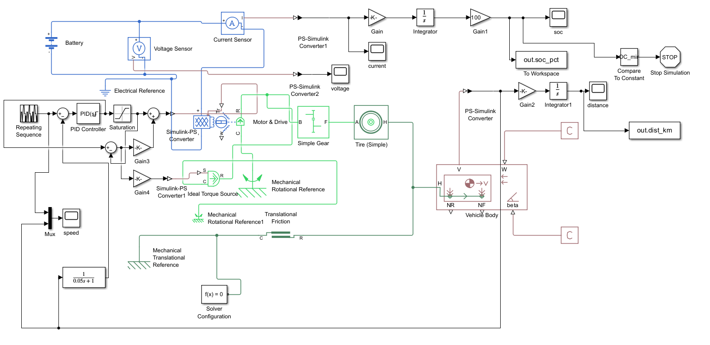
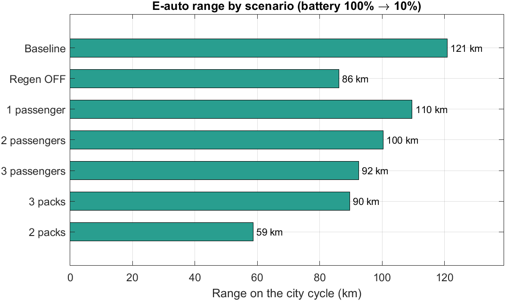
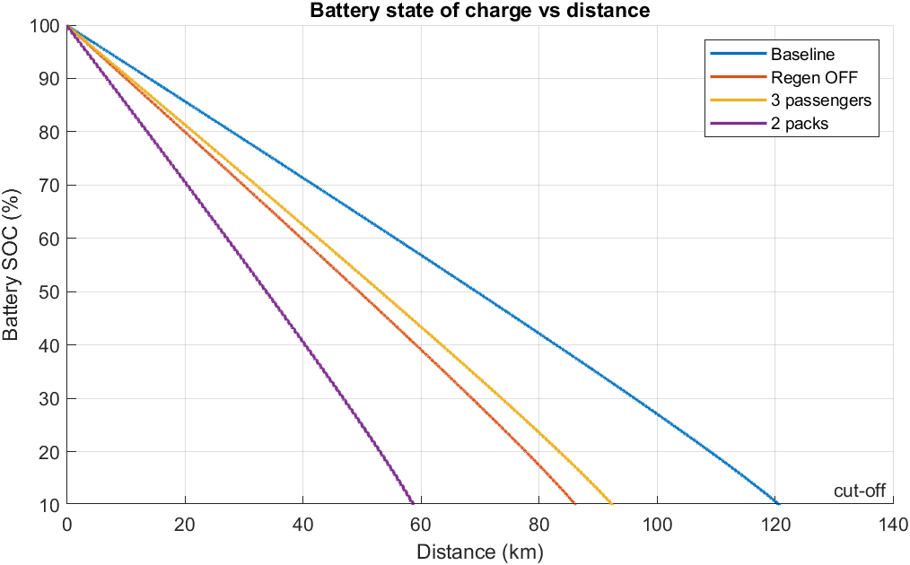
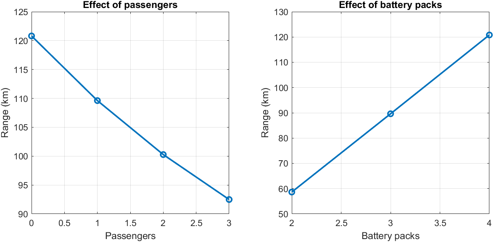

# Electric Auto-Rickshaw Range Simulation (MATLAB / Simulink / Simscape)

A physics-based model of an Indian electric 3-wheeler (e-auto). It drives itself through a city drive cycle and predicts **how far the auto can go on one battery charge**. It also shows how that range changes with **regenerative braking**, **passenger load** and **number of battery packs**.



## Key results

| Scenario | Range (km) | Energy use (Wh/km) |
|---|---|---|
| **Baseline**: driver only, 4 packs, regen ON | **121** | 46 |
| Regen braking OFF | 86 | 64 |
| 1 passenger | 110 | 50 |
| 2 passengers | 100 | 55 |
| 3 passengers | 92 | 60 |
| 3 battery packs | 90 | 46 |
| 2 battery packs | 59 | 47 |

*Range is measured from 100% to 10% battery on a repeating city cycle (average 18 km/h).*

**Findings**
- **121 km baseline range.** This is within about 10% of the ~110 km quoted for commercial 4-pack e-autos.
- **Regenerative braking adds about 41% range** in stop-start city driving (86 → 121 km).
- **A full load of 3 passengers costs about 24% range** (121 → 92 km).
- **Each battery pack gives about 30 km.** Range scales almost linearly with packs, so a full day of driving (120–150 km) needs 4+ packs. This is why battery swapping suits 3-wheelers.





## What the model contains

| Subsystem | Implementation |
|---|---|
| **Vehicle** | Simscape Driveline *Vehicle Body* + *Tire (Simple)*: 520 kg, Cd 0.6, 2.0 m², rolling resistance Crr 0.015 |
| **Motor** | Simscape Electrical *Motor & Drive (System Level)*: 6 kW peak, 25 N·m, with efficiency losses |
| **Gearbox** | *Simple Gear*: 7:1 ratio, 95% efficiency |
| **Battery** | Simscape Electrical *Battery*: 51.2 V, 4 × 30 Ah packs (6.1 kWh), internal resistance |
| **BMS / SOC** | Current and voltage sensors; SOC by coulomb counting |
| **Driver** | PI speed controller with output saturation and anti-windup, following a city drive cycle modelled on India's IDC (0–42 km/h, 108 s, 0.54 km) |
| **Regen braking** | Torque request split into drive and braking parts; braking goes to the motor (regen ON) or to a friction brake (regen OFF) |
| **Automation** | `run_experiments.m` runs 7 scenarios to 10% SOC and produces the table and plots |

## Validation
- **Vehicle model:** with a constant 40 N·m wheel torque, the simulated top speed (46.5 km/h) matched the hand calculation from force balance (46.6 km/h).
- **Motor model:** shows a constant-torque region up to ~25 km/h, then a constant-power region. The simulated top speed (65.3 km/h) matched the power-balance calculation.
- **Battery:** the voltage drop under load (~1.6 V at 127 A) matched I × R_internal. SOC drop matched the amp-hours used.
- **Driver:** follows the drive cycle within ~0.5 km/h. Every experiment checks that the average speed equals the cycle average.

## How to run
Requires **MATLAB R2024b** with Simulink, Simscape, Simscape Electrical and Simscape Driveline.
```matlab
rickshaw_params      % load parameters (also runs automatically as the model's InitFcn)
open_system('rickshaw')
run_experiments      % runs all 7 scenarios (~5 min) and saves results/ plots + CSV
```

## Files
| File | Purpose |
|---|---|
| `rickshaw.slx` | Simulink/Simscape model |
| `rickshaw_params.m` | All vehicle, motor, battery, drive cycle and controller parameters |
| `run_experiments.m` | Batch scenario runner, results table and plots |
| `results/` | Plots and `experiment_results.csv` |

## Limitations and possible extensions
- Constant 25 °C, with no battery thermal model or temperature-dependent capacity.
- Battery pack mass is not changed when the number of packs changes.
- Regen recovery is idealised: no low-speed regen cut-off or charge-current limit. Real-world regen gains are typically lower (about 15–25%).
- The drive cycle is a simplified city cycle modelled on India's IDC, not the official IDC data.
- Possible extensions: thermal model, hill (road grade) scenarios, a motor efficiency map, and battery-swap scheduling for a fleet.
